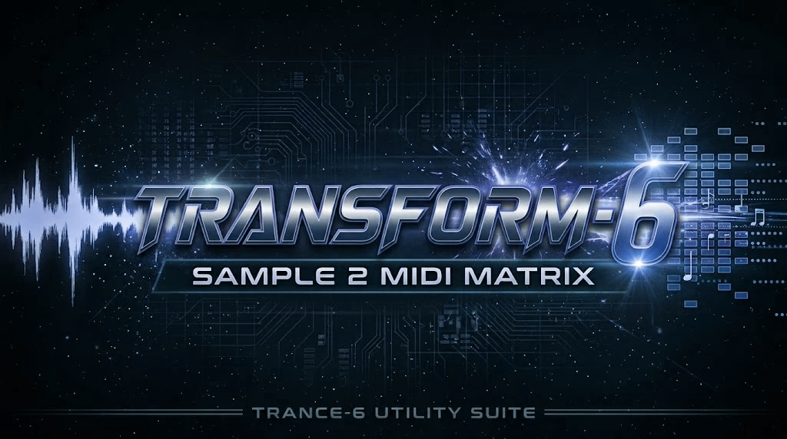

  

# TRANSFORM-6

**Sample → MIDI Matrix.** Part of the TRANCE-6 utility suite, alongside the VIBRA-VII plugin.

Drop in a sample → it splits it into parts (vocals, drums, bass, guitar, piano, other) if there's more than one instrument → finds the notes in each part → you drag the MIDI (or the separated audio) straight onto a track in FL Studio or Ableton.

Works as a **VST3 plugin** (FL Studio, Ableton Live) and as a **standalone app**. Everything runs on your own PC — nothing gets uploaded anywhere.

---

## Using it

1. **Drop a sample** on the big box (or click it to browse). WAV, MP3, FLAC, AIFF and OGG all work.
2. **What's in the sample**
   - *Auto-detect* (default) — splits it, then throws away parts that are basically silent. If only one instrument is really there, it uses your original audio for the best detail.
   - *Several instruments – split it* — always split.
   - *One instrument – don't split* — fastest. Pick the instrument type: Melodic, Drums, Bass, or Vocals / lead line.
3. **Sensitivity** — slide left if you're getting junk notes, right if it's missing quiet notes.
4. **Snap to grid** — *Off* keeps the human feel. 1/16 lines everything up to the grid.
5. **Tempo** — leave on *Auto*, or type your project's BPM so the MIDI lines up perfectly.
6. Click **Convert to MIDI**.
7. Each part gets a row:
   - **Play** — hear that part through the plugin.
   - **MIDI** tag — drag it onto a track / the Channel Rack / the Piano Roll.
   - **WAV** tag — drag the separated audio (the "stem") into your project.
   - **All parts** — one MIDI file with every part on its own track.

Files are also saved to **Documents › TRANSFORM-6** (change it with *Save to*). *Open folder* takes you there.

### Recording a sample (standalone app)
Instead of dropping a file, click **Record** to capture straight from your audio interface, then **Stop** — the take loads automatically, ready to Convert. The live input level and elapsed time show on the bar while recording. Takes are saved under your output folder in a `recordings` subfolder.

First time only: open the standalone app's **Options**, pick your interface as the input device, and make sure **"Mute audio input"** is unticked (it's on by default to prevent speaker feedback). If a take comes out silent, that setting is why.

### What it does with drums
Drum parts come out as standard drum-kit MIDI: **kick = C1 (36), snare = D1 (38), closed hat = F#1 (42), open hat = A#1 (46)**. That lines up with FPC in FL Studio and Drum Rack in Ableton.

### How long it takes
Single instrument: a few seconds. Splitting a full 3-minute song on an ordinary processor: roughly 1–3 minutes. Short loops are quick.

---

## Installing on Windows

The installer (**TRANSFORM-6-Setup.exe**) is built automatically by GitHub from this project — see the **Actions** tab. Run it and it puts:

- the plugin in `C:\Program Files\Common Files\VST3` (where FL Studio and Ableton already look)
- the app and its engine in `C:\Program Files\TRANSFORM-6`
- a Start menu shortcut

Then:
- **FL Studio:** Options › Manage plugins › *Find installed plugins*. It shows up under Effects. Add it to any mixer slot.
- **Ableton:** Preferences › Plug-ins › make sure *Use VST3 Plug-in System Folders* is on, then *Rescan*. It shows up under Plug-ins › Pathfinder Pressings.

If it ever says it can't find the engine, click **Find engine** and pick `C:\Program Files\TRANSFORM-6\engine\transform6-engine.exe`.

---

## Installing on macOS

Download **TRANSFORM-6-macOS.dmg** (a universal build — runs natively on Apple Silicon and Intel), open it, and read **READ-ME-FIRST.txt** inside. Because this is an unsigned test build, macOS Gatekeeper needs two quick steps: right-click the `.pkg` and choose *Open* to install, then run the one `xattr` command in the readme to clear the quarantine flag so the app and plugins load.

It installs the VST3 (and an **AU** for Logic/GarageBand) into the standard plug-in folders, and the app plus engine into `/Applications/TRANSFORM-6`. Rescan plug-ins in your DAW. To record from an audio interface, allow microphone access when the standalone app asks.

---

## What's inside (for the curious)

| Folder | What it is |
|---|---|
| `engine/` | The brains (Python). Splitting uses **Demucs** (Meta's open 6-part splitter). Note-finding uses **Basic Pitch** (Spotify's open model) plus custom clean-up: splits repeated notes, removes overtone "ghost" notes, keeps bass and vocals to one note at a time. Drums use a custom hit detector that sorts each hit into kick / snare / hat. |
| `plugin/` | The VST3 plugin + standalone app (JUCE / C++). Runs the engine in the background and shows the results. |
| `installer/` | The Windows installer script. |
| `.github/workflows/` | Tells GitHub how to build the installer. |

Engine test results on a known test loop (4 bars, 100 BPM): melody 100%, chords 100%, drums 96%, bass 88% of notes found.

---

## License

TRANSFORM-6's own code is released under the [MIT License](LICENSE). It bundles third-party models and libraries under their own terms: **Demucs** (MIT, Meta), **Basic Pitch** (Apache-2.0, Spotify), and **JUCE** (see the JUCE license).
